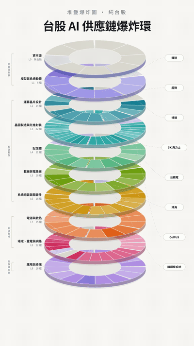

<p align="center">
  
</p>

<h1 align="center">台股 AI 供應鏈<br>地層剖面</h1>

<p align="center">
  <b>一張圖，看懂台股 AI 的錢往哪裡流。</b><br>
  150 多檔台股、十層、160 多條關係線，每個交易日收盤後用證交所與櫃買中心的官方資料自動更新。
</p>

<p align="center">
  <a href="https://meimeijazz1206.github.io/ai-chain/rings.html"><b>▶ 打開爆炸環</b></a>　·　
  <a href="https://meimeijazz1206.github.io/ai-chain/">地層剖面</a>　·　
  <a href="https://meimeijazz1206.github.io/ai-chain/signals.html">市場訊號</a>
</p>

<p align="center">覺得有用的話，請按一下頁面上方的 ⭐ <b>Star</b>，讓更多人看到這張圖。</p>

## 這張圖在講什麼

外面的 AI 供應鏈圖多半只畫「誰供貨給誰」，每張用的分類都不一樣，所以串不起來。
這張只用一條軸：**錢的流向**。從出錢買算力的雲端巨頭與 AI 公司開始，看錢流進晶片、封裝、
記憶體、伺服器，以及讓機房能開機的電力、散熱與網路。

- **點一層**：那片圓盤會浮出來、轉正面對你，整層公司一次攤開
- **點一家公司**：連到它的線全部亮起來。關係分成供應、綁定、替代、排擠、持股、同集團六種，用顏色區分
- **每條線都標了可信度**：公司揭露、媒體報導、產業推測、產業共識。推測級的線可以拿來想，不能拿來當進場理由

## 資料怎麼確保是對的

- **數字**：股價、本益比、毛利率、營收年增都來自證交所與櫃買中心的開放資料。每次發布前先跑自我檢查，沒過就不上線
- **說法**：公司描述與關係線定期輪替查證，每一則修正都附原始報導連結，顯示在網頁上方的跑馬燈
- **不當成來源的**：社群貼文、電視節目截圖、AI 生成的表格與摘要，只能當找資料的線索

## 關於

我是 Mei。這原本是我自己研究台股 AI 供應鏈的筆記，整理成大家都能點開來看的圖。
發現說錯的地方，歡迎開 [Issue](https://github.com/meimeijazz1206/ai-chain/issues) 告訴我。

> 僅供研究參考，不構成投資建議。

---

以下是技術說明，給想自己架站或改資料的人。

## 快速啟動

```bash
python3 scripts/serve.py 8099
```

然後開 http://localhost:8099

## 每日更新行情

```bash
python3 scripts/fetch_official.py
```

只用 Python 標準函式庫，不用另外裝套件。輸出 `data/quotes.json`、`data/history.json`、
`data/revenue.json`，前端直接讀靜態檔，沒有後端。

`chain.json` 只存四位數代號，上市或上櫃由官方資料自動判斷，新增個股時不用管。

## 檔案結構

| 檔案 | 作用 |
|---|---|
| `data/chain.json` | 唯一要手動維護的檔案。層、群組、個股、關聯線、主題 |
| `data/quotes.json` | 腳本產生，勿手改 |
| `data/history.json` | 約半年的每日收盤，算半年位階與月線用，腳本產生 |
| `data/revenue.json` | 月營收，算營收年增用，腳本產生 |
| `data/updates.json` | 跑馬燈，每一則都附原始來源連結 |
| `data/suffix.json` | 舊 Yahoo 版的上市櫃後綴快取，公開網站不使用 |
| `index.html` | A 款地層剖面。垂直分層，抽屜式展開 |
| `rings.html` | B 款爆炸環。十片圓盤堆疊，點層浮出，巨頭衛星拉線。網址加 `?demo` 是錄影示範模式 |
| `signals.html` | AI 市場訊號 |
| `scripts/fetch_official.py` | 抓行情。證交所與櫃買中心官方開放資料，公開網站用這支 |
| `scripts/backfill_history.py` | 回補約半年官方收盤，算半年位階用；新增公司時也用它補 |
| `scripts/backfill_revenue.py` | 一次性回補前兩個月的月營收，算近三個月累計年增用 |
| `scripts/verify.py` | 上線前的自我檢查，有錯誤就不發布 |
| `scripts/review.py` | 說法的每日查證入口，見下方「說法的每日查證」 |
| `scripts/build_site.py` | 建置 `_site/` 給 GitHub Pages |
| `scripts/fetch_quotes.py` | 舊的 Yahoo 版，只留給本機研究，**公開網站不使用**（Yahoo 條款限制轉載） |
| `scripts/serve.py` | 本機靜態伺服器 |
| `scripts/format_chain.py` | chain.json 格式化。用程式改過資料後一律用它寫回 |
| `scripts/build_standalone.py` | 打包成單檔，index、rings、signals 三頁各出 standalone 與 artifact 兩種（舊 Artifact 用，公開網站不使用） |

## 兩種畫法

同一份 `chain.json` 兩種渲染，不是兩份資料。改資料兩邊同時生效。

| | A 地層剖面 | B 爆炸環 |
|---|---|---|
| 檔案 | `index.html` | `rings.html` |
| 形式 | 垂直分層，抽屜式展開 | 十片等角投影圓盤堆疊，浮出並轉正 |
| 強項 | 逐檔比較數字、篩選與搜尋 | 一眼看出層的相對規模、巨頭的觸角範圍 |
| 弱項 | 巨頭關聯線要跨很長的捲動距離 | 沒有篩選與搜尋，不適合大量比數字 |

### 為什麼從同心圓改成堆疊圓盤

第一版 B 用同心圓，有個先天缺陷：**越內圈周長越短**。L0 只有 9 個節點卻擠在圓心動不了，
L3 有 27 個節點反而分不到角度，兩邊都難讀。改成堆疊之後每一片圓盤半徑相同，
**每層拿到一樣大的圓周**，節點多寡只影響扇形寬窄，不再受半徑懲罰。

立體感靠四件事堆出來，沒有用任何 3D 函式庫：等角投影把圓壓成橢圓（`FLAT` 係數）、
前半圈外緣往下擠出側牆做厚度、每片下方投一個橢圓陰影、由下往上繪製讓上片正確遮住下片。
選中的那片會浮起並把傾角轉回接近正圓（`FOCUS_TILT`），這時候才有足夠圓周放得下所有標籤。
待機時整疊會極輕微地上下浮動，選取或 `prefers-reduced-motion` 時停止。

用程式修改 `chain.json` 時，直接 `json.dump` 會把每檔個股攤成五六行。請改用：

```python
import format_chain
data = json.loads(format_chain.CHAIN.read_text(encoding="utf-8"))
...                       # 修改 data
format_chain.write(data)  # 個股與關聯線各維持一行
```

## 資料模型

### 三條鏈，十層

十層分屬三條鏈，寫在每層的 `chain` 欄位。**同一條鏈之內上下才是真的上下游，跨鏈之間
只是排版順序。** 重電不是記憶體的下游，兩者平行發生。這是第一版最容易被誤讀的地方。

| 鏈 | 層 | 意義 |
|---|---|---|
| `demand` 需求與變現 | L0 資本源、L1 模型與系統軟體、L9 應用與終端 | 錢的出口與回收 |
| `hardware` 硬體製造 | L2 晶片設計、L3 晶圓與封裝、L4 記憶體、L5 載板與 PCB、L6 系統組裝 | 把錢變成晶片與伺服器 |
| `infra` 基礎設施 | L7 電源與散熱、L8 場域重電與網路 | 讓算力能開機的電、熱、網路 |

L1 台股標的很少，這是刻意保留的稀缺層。空層本身就是資訊，它說明台股吃不到模型與
軟體層的利潤，只能吃代理與落地服務。

### 節點類型

`kind` 欄位區分四種節點，因為技術標準不是公司，不該長得跟公司一樣：

| kind | 意義 | 例子 |
|---|---|---|
| `company` | 台股上市櫃公司，有代號有行情 | 台積電、奇鋐 |
| `anchor` | 外部公司，不列代號不抓價，只為讓關聯線成立 | 輝達、SK 海力士 |
| `standard` | 技術架構或標準，不是可買的標的 | CoWoS、機櫃級系統、CXL、HBF |
| `segment` | 需求類型而非單一買方 | 主權 AI |

### 個股欄位

```json
{ "code": "2330", "name": "台積電", "role": "一句話定位",
  "purity": 3, "bottleneck": 5, "subst": 1, "cross": ["L6","L7"] }
```

- `purity` 含金量，AI 營收占比，1 到 5
- `bottleneck` 瓶頸度，有沒有定價權，1 到 5
- `subst` 可替代性，5 代表最容易被換掉
- `cross` 選填，橫跨多層的公司。**要含自己的主節點層**，例如台達電是 `["L7","L8","L9"]`。
  卡片會直接印出層代號，面板會列出每一層並標出哪一層是主節點，點了可以跳過去。
  判斷標準是「在本分類法中有實質營收落在一層以上」，只靠出貨關係連到別層的不算，
  那是 `edges` 的工作。目前標了 36 檔，可用篩選列的「跨層公司」一次看完
- `ext: true` 代表外部錨點，非台股，不抓行情，卡片顯示為斜線底

三個評分都是主觀判斷，用來比較同一層裡誰比較純、誰比較有定價權，不是公司揭露數字。
**每一分代表什麼寫在 `meta.rubric`**，介面上把游標移到評分名稱就會顯示。沒有規則的
主觀分數等於沒有資訊，所以改資料時請照 rubric 判斷，不要憑印象給分。

注意 `subst` 的方向與另外兩項相反：含金量與瓶頸度是越高越好，可替代性是**數字越大
代表越容易被換掉**。這是第一版最常被誤讀的欄位。

### 六種關聯線型

這是這張圖跟外面圖表最大的差別。關係不只一種型態：

| 型態 | 意義 | 例子 |
|---|---|---|
| `supply` 供應 | 實體出貨或提供服務 | 台光電 供 CCL 給輝達平台 |
| `alliance` 綁定 | 共同設計或獨家，替換成本高 | 輝達 與 台積電 |
| `substitute` 替代 | 彼此競爭的平行路線 | 液冷 取代 氣冷 |
| `crowding` 排擠 | 前者吃掉產能，後者供給緊縮而漲價 | HBM 排擠 一般 DRAM，南亞科受惠 |
| `equity` 持股 | 資本關係，不必然有出貨 | 輝達 入股 英特爾、CoreWeave |
| `group` 同集團 | 同母集團或分割出來 | 華碩、和碩、景碩 |

排擠型受惠的漲跌節奏跟直接供應完全不同。混在一起看，就會解釋不了為什麼有些股票
明明沒接到單也漲。

### 可信度標籤

`conf` 欄位標在關聯線上，用來區分這條線的證據強度：

| 值 | 意義 |
|---|---|
| `disclosed` | 公司或官方揭露 |
| `reported` | 媒體與法人報導，公司未證實 |
| `inferred` | 產業推測，從技術規格、產能配置或客戶結構反推 |
| `common` | 產業共識，多方報導一致且長期成立，但沒有單一權威出處 |

**每一條線都必須有 `conf`，沒有例外。** 留白的線會被當成已確認的供應關係，那是這份
資料最容易造成誤判的地方。新增關聯線時若不確定，先填 `common`。
推測級的線可以拿來想，不能拿來當進場理由。

### 瓶頸主題

`themes` 是跨層的族群視角，用來對應當下真正在動的題目。點一次亮出整個族群，
看它分布在哪幾層。例如記憶體缺貨、玻纖布與銅箔、CPO 與矽光子、企業 AI 落地。
新增主題只要在 `themes` 加一筆，列出 `codes` 即可。

### 跨層參照

同一個代號在資料裡只能出現一次，主節點放在營收主體所在的層。若另一層的邏輯少了它會
不完整，用群組的 `refs` 加參照卡，配 `refNote` 說明為什麼。例如華碩主節點在 L9，
但透過台智雲也屬於 L1。

## 新增個股

編輯 `data/chain.json`，在對應層的 `groups[].nodes` 加一筆，然後重跑 `scripts/fetch_official.py`，
再用 `scripts/backfill_history.py` 補半年股價。
關聯線加在最外層的 `edges`，兩端都必須是已存在的 `code`，否則會被自動忽略。

## 抓價的坑（舊 Yahoo 版）

1. Yahoo 會在盤前補一列當日尚未成交的空白資料，`Close` 是 `NaN`。直接取最後一列會讓
   整批行情變成 `NaN` 而且不報錯。腳本已用 `dropna()` 處理，並在寫檔前做 NaN 檢查，
   一旦發現就中止不覆寫。
2. 上市與上櫃後綴不同。腳本會自動試 `.TW` 再試 `.TWO`，過程中 Yahoo 會噴
   `possibly delisted` 警告，那是預期行為不是錯誤。

## 收錄門檻

節點的判準是「在 AI 資本支出傳導這條軸上有實質純度」，不是「這家公司跟 AI 沾得上邊」。
沾邊就收會讓地圖失去參考性，所以以下幾類刻意不收：

- 主力在車用高階板或低軌衛星的 PCB 廠
- 綜合被動元件巨頭。要放就放受惠最直接的高階電感與固態電容，不放整家公司
- 寬頻 CPE 與家用路由器的網通代工廠。AI 資料中心用的是 400G 與 800G 交換器，
  台股近乎由智邦獨佔，混入家用設備會讓人以為它們吃得到 AI 資本支出

## 還沒做的事

這份目前的定位是**供應鏈導覽**，不是選股終端。要升級成後者還缺：

- **公司卡片的研究欄位**。客戶集中度、產能與交期、受惠條件與失效條件，官方開放資料
  拿不到，要逐家讀年報與法說。150 多檔要人工整理，這是最大的一筆成本。
  單檔深挖建議接到既有的 stock-thesis 流程，不要在這裡重造。
- **出處網址逐條掛上**。關聯線有 `conf` 可信度與 `checked` 查證日期，公司描述也已納入
  `review.py` 的輪替查證，查過的節點會帶 `checked`；但出處網址目前只放在跑馬燈的
  `data/updates.json`，還沒逐條掛到關聯線上。
- **技術標準的台股對應**。技術標準節點透過關聯線連到台股，CPO、機櫃級系統已經接上；
  CXL、SOCAMM 還沒有任何一檔台股連上。UALink 尚未收錄。補的時候照規則先查證。
- **鏈的視覺重構**。三條鏈目前只在尺標與層標籤上標示，版面仍是單一垂直堆疊。
  真要做成三欄平行佈局是下一版的事。

## 已知限制

- 收盤後才更新的官方日資料，不是即時報價，不適合當看盤工具
- 關聯線是公開資訊整理，不是公司揭露的供應商名單，部分標註「產業推測」
- 目前是純台股。官方開放資料只有台股，若要加美股個股，得另外找報價來源

## 公開到 GitHub Pages

網址是 `https://meimeijazz1206.github.io/ai-chain/`。

| 檔案 | 用途 |
|---|---|
| `scripts/build_site.py` | 建置 `_site/`，只帶三個對外頁面與 `data/` 的三個 JSON（報價、供應鏈、跑馬燈） |
| `.github/workflows/pages.yml` | 推送到 main 就自我檢查、建置、發布。**檢查不過就不發布** |
| `.github/workflows/daily-quotes.yml` | 每個交易日台灣時間 18:30 在雲端抓報價與月營收，通過檢查才提交並觸發發布。GitHub 的排程常延遲數小時，屬正常現象 |

跟 Artifact 版的差別：GitHub 版的頁面直接讀 `data/*.json`，不內嵌快照，
所以每天只要更新 JSON，網站就是最新的，不會出現「快照過期」。

**刻意不公開的東西**：`teardown.html` 與 `data/products.json` 寫在 `.gitignore`，
連 git 都不追蹤。公開 repo 的每一個追蹤檔案任何人都看得到，只靠「不部署」不夠。
`build_site.py` 最後也會檢查，萬一它們出現在輸出裡就讓建置失敗。

雲端排程只能自動化「數字」。關聯線的說法對不對，程式驗不出來，
仍然要人工或 Claude 查證後修改 `data/chain.json` 再推上來。

## 漏抓的交易日會自己補

GitHub 的排程偶爾整次沒跑。2026-10-13 就漏了一天，結果兩天的漲跌被當成一天，
大量（3167）的 −11.5% 超過台股單日 10% 漲跌幅，才被檢查擋下來；其他股票則是悄悄算錯半年位階與月線。

`fetch_official.py` 現在每次都會對照證交所的休市日曆，檢查近 30 天有開市卻沒資料的日子並補抓。
休市日曆來自 `openapi.twse.com.tw/v1/holidaySchedule`，表上「開始交易日」「最後交易日」那兩天有開市，要排除。

新增公司時，半年股價用 `scripts/backfill_history.py` 補：它會找出「整體有、但新公司沒有」的日子逐日補齊，
新公司那幾天的資料不會被跳過。

## 說法的每日查證

股價、營收與發布由 GitHub 雲端處理；「說法還對不對」由 Claude 排程每天查證，入口是 `scripts/review.py`。
排程只需要授權這一支指令加上網路搜尋，所有修改都透過它，不直接改檔。

| 子指令 | 用途 |
|---|---|
| `start [N]` | 同步 GitHub、跑自我檢查，列出今天最該查證的 N 項（預設 5） |
| `ok ID ...` | 查證後仍然成立，蓋上今天日期 |
| `fix ID --text ... --ticker ... --source ... --url ... --expect ...` | 說法要改，可一併調整可信度或線型。先核對來源，再一次寫進資料與跑馬燈 |
| `ticker ... --expect ...` | 單獨加一則跑馬燈動態，同樣要通過來源核對 |
| `finish` | 再檢查一次，有變更才提交並推上 GitHub |

**來源核對**：`fix` 與 `ticker` 會先打開來源頁。AI 生成的頁面一律退回；`--expect` 至少給兩個
關鍵字（新說法裡的數字、日期、公司或產品名），而且都要真的出現在那一頁上，否則資料一個字都不動。
2026-10-16 第一次排程就把 TechNews 的 AI 問答頁當成來源，還把別篇報導的時程掛在另一篇底下，
才加上這一關。搜尋引擎回來的摘要本身也是 AI 寫的，只能當線索。

輪替對象包含關聯線、主題說明與節點描述，不確定性越高的越常查：推測、報導與已揭露的關聯線每 60 天，
主題說明每 45 天，節點描述每 120 天，產業共識的關聯線每 180 天。共識級的線也要輪替，
2026-10 的總體檢就發現一條標成共識的線其實只是媒體報導。從沒查證過的項目會分批排進未來，
不會讓快到期的推測級關聯線排不到。

排程刻意不能新增或刪除公司與關聯線，查到該增刪的會寫進回報，交給人決定。

## 官方資料的取捨

| 欄位 | 來源 | 說明 |
|---|---|---|
| 收盤、漲跌 | 證交所每日收盤行情、櫃買 OpenAPI | 證交所的 OpenAPI 版落後一天，所以上市用官網端點 |
| 本益比、淨值比、殖利率 | 證交所 BWIBBU、櫃買 peratio | 本益比用近四季獲利，虧損公司不計 |
| 毛利率、營益率 | 兩邊的營益分析 | **最新一季**，不是近四季，面板上會標出季別 |
| 市值 | 已發行股數 × 收盤價 | |
| 半年位階、月線 | `data/history.json` 自己算 | 官方沒有現成欄位，靠每天累積收盤 |
| 預估本益比 | 無 | 那是分析師預估，官方不發布，頁面改顯示殖利率 |
| 營收年增 | 兩邊的每月營業收入彙總表，存在 `data/revenue.json` | **以近三個月累計為主**，單月為輔。單月容易被去年低基期或一次性大單拉高 |

日期一律以櫃買的最新交易日為基準，再去拿證交所同一天，兩個市場的收盤日永遠一致。
切換到官方資料當天，147 檔的收盤價、漲跌幅、上市櫃判斷與原本 Yahoo 資料逐檔比對，零差異。

月營收的驗證：自己算出的單月年增必須跟官方公布的百分比一致（誤差 0.5 個百分點內），
不一致就整檔留白，不顯示可能錯位的數字。導入當天另外對了兩個外部錨點：台積電 2025 年
6 到 8 月營收與實際公布值相同，南亞科 2026 年 8 月單月年增算出 560.9%，與新聞報導的 560.85% 一致。
KY 公司在公開資訊觀測站放在「外國企業」那一頁，回補時漏抓會少掉世芯、訊芯等六檔。
